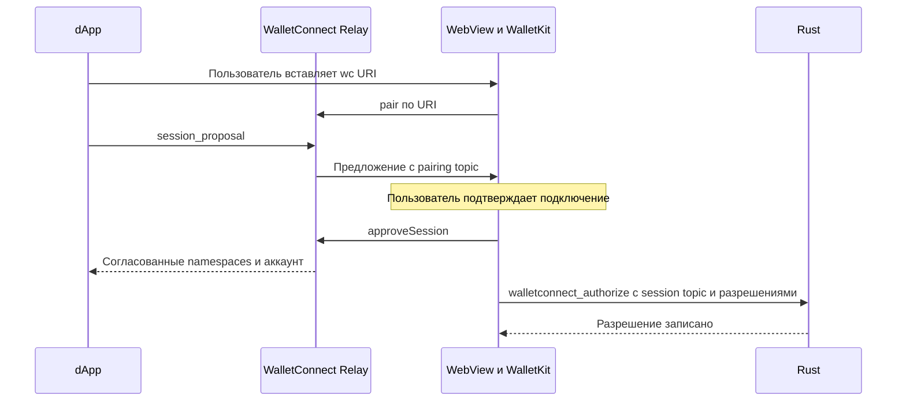
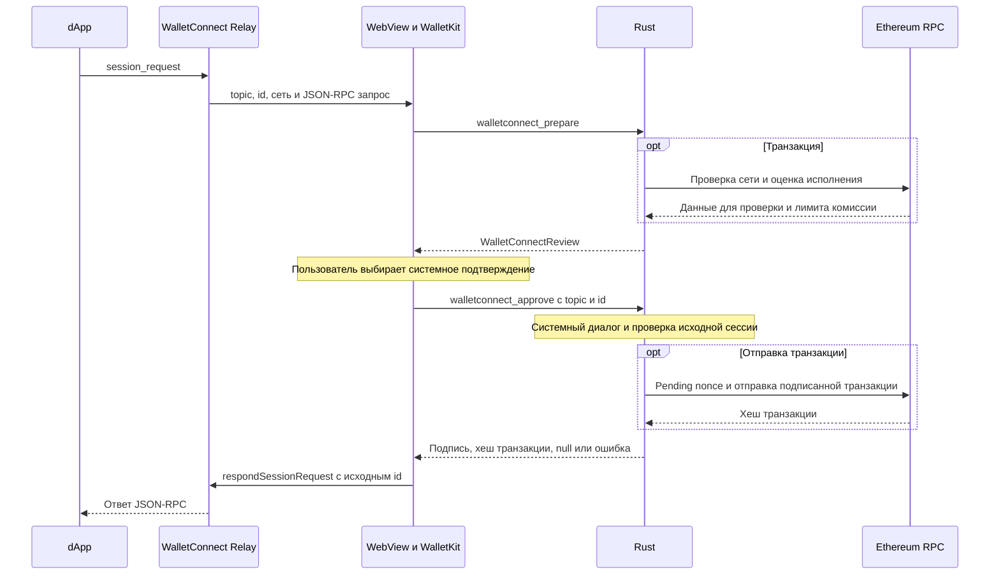

# Архитектура WalletConnect в Satellion

Satellion подключается к dApp как кошелёк WalletConnect v2. WebView получает запросы через Reown WalletKit, показывает подключение и передаёт параметры операций в Rust через Tauri IPC. Rust проверяет запрос, формирует данные для предпросмотра, открывает системное подтверждение и подписывает операцию ключом активного Ethereum-аккаунта. WalletKit возвращает dApp результат через relay, а подписанную транзакцию Rust отправляет напрямую в Ethereum JSON-RPC.

## Компоненты и границы доверия

| Компонент | Ответственность | Код |
| --- | --- | --- |
| Svelte WebView | Показывает подключение, разрешения по сетям и предпросмотр операции из Rust. Диалог управляет действиями пользователя, а отдельные компоненты отображают список подключений и детали запроса. | [Диалог](../../../../../src/routes/ethereum/view/WalletConnect.svelte), [подключения](../../../../../src/routes/ethereum/view/WalletConnectOverview.svelte), [предпросмотр](../../../../../src/routes/ethereum/view/WalletConnectReview.svelte) |
| WalletConnectVM | Управляет состояниями подключения и рассмотрения запроса, вызывает Tauri IPC и привязывает ответ Rust к текущему запросу. | [WalletConnectVM](../../../../../src/routes/ethereum/view_model/walletconnect.svelte.ts) |
| WalletKit и WalletConnect Core | Ведут pairing и relay-сессии. Ключи канала и состояние SDK хранятся в памяти WebView. | [Relay](../../../../../src/routes/ethereum/walletconnect/relay.ts), [разбор протокола](../../../../../src/routes/ethereum/walletconnect/protocol.ts) |
| Rust | Команды Tauri принимают IPC-вызовы. Подготовка связывает проверенное действие с предпросмотром. Модуль подтверждения проверяет актуальность разрешения и исполняет действие после согласия пользователя. | [Команды](../walletconnect.rs), [подготовка](../walletconnect/request.rs), [подтверждение и исполнение](../walletconnect/approval.rs), [состояние запросов](../walletconnect/state.rs) |
| Ethereum RPC | Возвращает состояние сети и оценку газа, принимает подписанную транзакцию. При подготовке и исполнении транзакции Rust сверяет `eth_chainId` с ID сети из запроса. | [Проверка RPC](../provider.rs), [отправка](../submission.rs) |

Метка домена в WebView строится из WalletConnect Verify. `INVALID` и `isScam` отклоняются, а домен без подтверждения отображается как непроверенный. Если при подключении и при запросе получены два разных подтверждённых домена, запрос отклоняется. Для доступа WebView к relay и Verify действуют ограничения CSP. [Проверка домена](../../../../../src/routes/ethereum/walletconnect/protocol.ts), [CSP](../../../../tauri.conf.json)

## Сети и настройки

Интеграция использует namespace `eip155`. Булевый параметр `eth.walletconnect_testnets` выбирает одну из двух пар сетей. [Реестр сетей](../walletconnect/settings.rs)

| Режим | Сеть и ID | RPC |
| --- | --- | --- |
| Основной | Ethereum `1` | `eth.rpc_url` |
| Основной | Base `8453` | `https://mainnet.base.org` |
| Тестовый | Sepolia `11155111` | `https://ethereum-sepolia-rpc.publicnode.com` |
| Тестовый | Base Sepolia `84532` | `https://sepolia.base.org` |

`eth.walletconnect_project_id` задаёт Project ID для подключения WalletKit. При пустом значении Rust использует встроенный ID. При включённом Tor или Anvil WalletConnect недоступен. [Конфигурация](../config.rs), [проверка режима](../walletconnect/settings.rs)

## Подключение dApp

1. При открытии WalletConnect на экране Ethereum WebView через `walletconnect_settings` получает Project ID, доступные сети и методы. Пользователь вставляет `wc:`-ссылку из dApp. Перед `pair` WebView проверяет формат WalletConnect v2, параметры relay и срок действия ссылки, если он указан.
2. `session_proposal` принимается только для ожидаемого pairing topic. В режиме ожидания предложения действует таймер 45 секунд. WalletKit строит namespaces из предложения dApp и возможностей кошелька. WebView показывает домен, активный адрес и методы отдельно для каждой сети согласованной сессии.
3. После согласия пользователя WalletKit вызывает `approveSession` и получает session topic. Затем `walletconnect_authorize` сохраняет в Rust разрешение с этим topic, адресом и методами для каждой сети. Rust проверяет совпадение адреса с активным Ethereum-аккаунтом. WebView добавляет dApp в список подключений после успешной записи разрешения, а при ошибке пытается отключить relay-сессию. [Поток подключения](../../../../../src/routes/ethereum/view_model/walletconnect.svelte.ts), [разрешения в Rust](../walletconnect/state.rs)



Pairing topic связывает ссылку с предложением. Session topic идентифицирует уже согласованное подключение и используется для последующих запросов и ответов.

## Запрос, подтверждение и исполнение



WebView проверяет наличие сессии в SDK и право вызывать метод в указанной сети. `walletconnect_prepare` получает `topic`, `id`, сеть, метод, JSON-параметры и срок действия. Срок ограничен сроком сессии SDK. Если dApp не указал срок для запроса, WebView использует пять минут в пределах срока сессии. Rust повторно проверяет аккаунт, сеть, метод, срок и уникальность ID в рамках разрешения. Объём JSON-параметров ограничен 128 КиБ, срок запроса в Rust ограничен семью сутками. [Формат запроса](../../../../../src/routes/ethereum/walletconnect/protocol.ts), [проверки Rust](../walletconnect/request.rs), [повторные запросы](../walletconnect/state.rs)

В Rust одновременно хранится один запрос на рассмотрении. Он проходит состояния `Preparing`, `Ready` и `Confirming`. В `Ready` подготовленное действие и данные предпросмотра хранятся вместе. `walletconnect_approve` принимает только `topic` и `id` и показывает системный диалог на основе того же предпросмотра, который получил WebView. Перед каждой страницей и после последней Rust проверяет срок запроса и отзыв доступа к сессии или разрешения dApp. Каждый экземпляр запроса получает собственный внутренний идентификатор. Если dApp использует тот же JSON-RPC ID после истечения срока, завершение старого запроса не может удалить новое подтверждение. [Состояния](../walletconnect/state.rs), [текст подтверждения](../walletconnect/review.rs), [системный диалог](../../../native_approval.rs)

Перед исполнением Rust проверяет исходную сессию кошелька, адрес подписанта и неизменность RPC. Одноразовое подтверждение расходуется под блокировкой сессии. Транзакции WalletConnect и обычные Ethereum-переводы используют общую очередь, которая сериализует чтение pending nonce, подпись и отправку. Если dApp указал nonce, он должен совпасть с актуальным. При отправке хеш от RPC сверяется с хешем подписанного конверта. [Исполнение WalletConnect](../walletconnect/approval.rs), [защита подписи](../../../session/session_keeper.rs), [очередь отправки](../submission.rs), [проверка хеша](../provider.rs)

WalletKit отправляет успешный результат или ошибку с исходным JSON-RPC ID. Отказ пользователя в WebView вызывает `walletconnect_reject`, а dApp получает код `4001`. Тот же код возвращается при отмене в системном диалоге. Если хеш транзакции уже получен, но ответ dApp не доставлен, WebView сохраняет хеш и сообщает об ошибке доставки. При неопределённом результате отправки RPC ошибка Rust содержит хеш подписанной транзакции для проверки перед повтором. [Ответы dApp](../../../../../src/routes/ethereum/view_model/walletconnect.svelte.ts), [отправка](../submission.rs)

## Поддерживаемые операции

| Метод | Что проверяет и показывает кошелёк | Результат для dApp |
| --- | --- | --- |
| `eth_sendTransaction` | EIP-1559, адрес отправителя, сеть, получатель и данные вызова. Rust симулирует транзакцию и рассчитывает верхнюю границу комиссии исполнения. Для Base отдельное уведомление указывает на возможную плату за данные L1. | Хеш отправленной транзакции |
| `personal_sign` | Адрес подписанта и читаемый ASCII-текст до 1024 байт. Подтверждение показывает текст и точные байты. | Подпись EIP-191 |
| `eth_signTypedData_v4` | EIP-712, включая `domain.chainId`, схему и значения. Для типов, распознанных как разрешение на расходование, требуется адрес контракта проверки. | Подпись хеша EIP-712 |
| `wallet_switchEthereumChain` | Целевая сеть должна входить в разрешённые сети dApp. | `null`, затем событие `chainChanged` для сессии |

Набор методов задан в [парсере запросов](../walletconnect/request.rs). Отдельный поток `session_authenticate` отклоняется WalletKit-обработчиком в [WebView](../../../../../src/routes/ethereum/view_model/walletconnect.svelte.ts).

### Переводы и мост Across

Для `eth_sendTransaction` Rust поддерживает отправку ETH без calldata на адрес без кода, `approve` для известных ERC-20 или для контракта, который подтверждает поддержку ERC-721, и ограниченный набор депозитов Across. У `approve` он показывает spender и, в зависимости от стандарта, allowance или NFT token ID. Вызовы, для которых отсутствует поддерживаемый формат предпросмотра, отклоняются.

Для Across разрешены `deposit`, `depositV3` и `depositNative` на адресах SpokePool и Periphery из реестра в коде, в пределах выбранной пары сетей. Rust декодирует фактическую calldata, проверяет адрес возврата, активы, направление и суммы. Поддерживаются депозиты с пустым `message`. Подтверждение показывает конечного получателя, сеть, сумму отправки и заявленную сумму получения. dApp запрашивает подпись и отправку через WalletConnect, а исполнение моста начинается в контракте после отправки транзакции в исходную сеть. [Валидация транзакций и Across](../walletconnect/transactions.rs)

## Отзыв разрешений и очистка

- **Отказ и истечение срока запроса.** WebView отсчитывает срок, переданный Rust, и также обрабатывает событие истечения срока WalletKit. Обе ветки убирают запрос из интерфейса и отменяют текущую подготовку в Rust. Если подтверждение уже выполняется, WebView ожидает его результат, чтобы сохранить хеш принятой транзакции. [Обработка срока в WebView](../../../../../src/routes/ethereum/view_model/walletconnect.svelte.ts), [отмена подготовки](../walletconnect/request.rs)
- **Отключение dApp.** При ручном отключении, удалении сессии или истечении её срока WebView удаляет подключение и вызывает `walletconnect_disconnect`. Rust отзывает разрешение и отменяет связанный запрос. Отзыв прерывает ожидание RPC при подготовке и останавливает отправку, если это ещё возможно. [Состояние разрешений](../walletconnect/state.rs), [отправка](../submission.rs)
- **Блокировка кошелька.** Программная или системная блокировка синхронно отзывает доступ к Rust-сессии даже при занятой блокировке `SessionKeeper`. WebView сбрасывает WalletKit и игнорирует запоздавшие ответы старого клиента. Истечение времени бездействия также завершает сессию кошелька. [Отзыв доступа](../../../session/session_keeper.rs), [сброс WebView](../../../../../src/routes/ethereum/view_model/walletconnect.svelte.ts)
- **Аккаунт и настройки.** Смена Ethereum-аккаунта или изменение настроек, от которых зависит WalletConnect, очищает локальные разрешения. При обычном сбросе WebView пытается уведомить dApp перед закрытием relay. При включении Tor relay закрывается без уведомления. [Команды аккаунта и конфигурации](../../../commands.rs), [закрытие relay](../../../../../src/routes/ethereum/walletconnect/relay.ts)

## Проверки при изменении интеграции

Команды запускаются из корня репозитория.

```bash
pnpm check
cargo test --manifest-path src-tauri/Cargo.toml --locked --lib walletconnect -- --test-threads=1
cargo test --manifest-path src-tauri/Cargo.toml --locked --lib chain::eth::submission -- --test-threads=1
cargo test --manifest-path src-tauri/Cargo.toml --locked --lib session::session_keeper -- --test-threads=1
```

Тест с локальным Anvil проверяет отправку штатного ETH-перевода, точное значение одобренного allowance и одноразовость подтверждения WalletConnect. В этом тесте программный обработчик заменяет системное окно и проверяет отказ пользователя, `personal_sign` и отзыв сессии до подписи. Отдельные тесты проверяют отключение до и после подписи. Для ручной проверки relay и нативного окна используется десктопное приложение, запущенное через `pnpm tauri dev`. [Интеграционные тесты](../walletconnect/tests.rs), [тесты отправки](../submission.rs)
